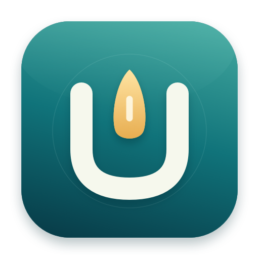
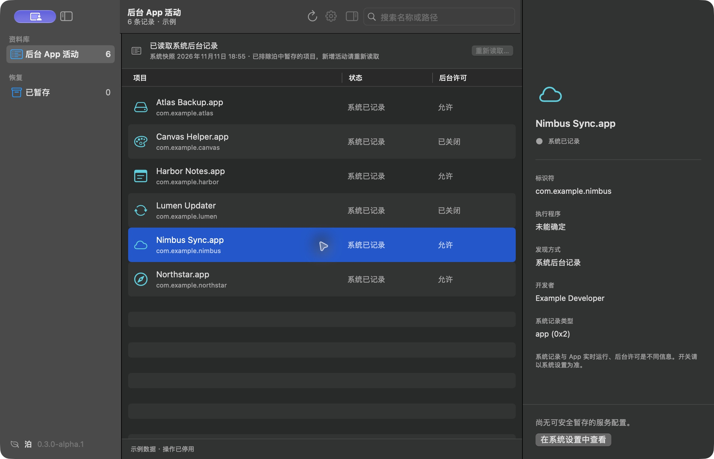

<p align="center"></p>
<h1 align="center">Berth · 泊</h1>
<p align="center">A quiet place for background apps.</p>
<p align="center">A small, native macOS utility to inspect, park, and restore background services.</p>
<p align="center"><a href="README.md">简体中文</a> · <strong>English</strong></p>
<p align="center"></p>

## What it does

Berth focuses on the items shown in System Settings → Login Items → Background App Activity. It groups system records by app or developer, explains their service configuration, and offers reversible parking when a supported service can be identified unambiguously.

- Native SwiftUI / AppKit interface, search, inspector, and settings.
- Back up a configuration before unloading and parking it; restore its original attributes and load state.
- Remove parked items from the activity view without editing the system background database.
- Reuse short-lived system authorization for consecutive reads. Never store passwords.
- No third-party dependencies, network access, accounts, telemetry, or installed background service.

The interface is currently in Simplified Chinese. The screenshot contains fictional demo data.

## Download

**[Download an Alpha preview from Releases](https://github.com/linzihong594/Berth/releases)**. Choose `arm64` for Apple silicon or `x86_64` for Intel. Open the DMG and drag Berth to Applications. Quit and replace the old app when updating; recovery data is stored separately.

Preview builds are ad-hoc signed and are **not Developer ID signed or notarized**. macOS may block the first launch. Review the source and download origin, or build locally. See [Apple's instructions](https://support.apple.com/en-us/102445); do not disable system security protections.

## Use

1. Click “读取系统列表…” to read the system list and complete macOS authentication.
2. Select an item and inspect its source. Supported items offer “暂存并停用服务…” to park and disable a service.
3. Restore it from “已暂存”. Restoration refuses to overwrite a different configuration.
4. Use “重新读取…” after installing an app or changing system activity. Regular refresh only updates local state.

The first read and reads after authorization expires may require administrator authentication. macOS determines whether Touch ID is available. A normal-user read host is released on exit, explicit session close, or five minutes of inactivity; there is no installed daemon. Failed, cancelled, or timed-out reads preserve the existing snapshot.

## Scope

Berth can manage ordinary current-user LaunchAgents and legacy system LaunchDaemons. Shared LaunchAgents, bundled app components, ambiguous matches, and records without a supported configuration remain read-only. Parking may affect an app's functionality. System Settings can retain stale records and applications may recreate configurations.

Berth does not edit the private background-task database, call `resetbtm`, modify app bundles, or write to `/System`. The diagnostic output of `sfltool` is not a stable API; projection rules require validation on more macOS versions.

## Build

Requires macOS 14+, Swift 6+, and Xcode Command Line Tools.

```sh
git clone https://github.com/linzihong594/Berth.git
cd Berth
./scripts/test.sh
./scripts/build-app.sh
open dist/Berth.app
```

`./scripts/package-release.sh` creates architecture-specific DMG, ZIP, and SHA-256 files. `open dist/Berth.app --args --demo` opens fictional, non-destructive demo data. `swift run berth-probe` is a read-only diagnostic; it never automatically requests administrator authorization.

CI builds on Apple silicon and Intel macOS runners. Build coverage does not imply runtime validation on every device or minimum OS. See [validation](docs/VALIDATION.md).

## Recovery data

- User archives: `~/Library/Application Support/Berth/Archives/`
- System archives: `/Library/Application Support/Berth/SystemArchives/`
- Snapshot: `~/Library/Application Support/Berth/SystemSnapshot.json`

Do not delete recovery directories while services are parked. Original backups remain after restoration. System restoration trusts the protected administrator-owned journal, never the display-only user copy.

## Contribute

Read [CONTRIBUTING](CONTRIBUTING.md), [SECURITY](SECURITY.md), the [roadmap](docs/PLAN.md), and [technical decisions](docs/DECISIONS.md). Please avoid posting raw system inventories or backup files in public issues.

Code and original icon artwork are available under the [MIT License](LICENSE).
