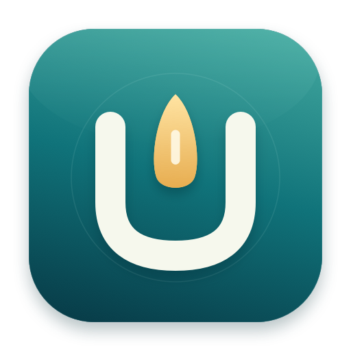
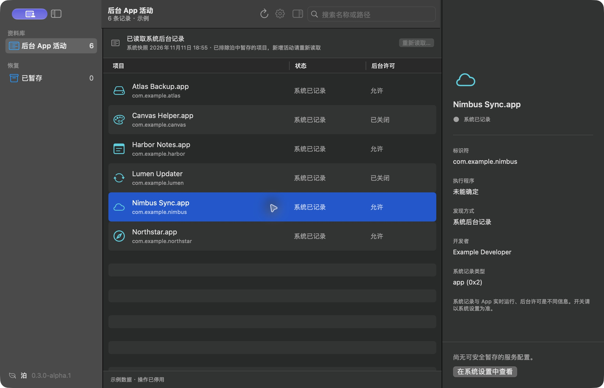

<p align="center">
  
</p>
<h1 align="center">泊 · Berth</h1>
<p align="center">给后台活动，一个安静的泊位。</p>
<p align="center">轻量、原生、可恢复的 macOS 后台活动管理工具。</p>
<p align="center">
  <a href="https://github.com/linzihong594/Berth/actions/workflows/ci.yml"></a>
  <a href="https://github.com/linzihong594/Berth/releases"></a>
  <a href="LICENSE"></a>
  
</p>
<p align="center"><strong>简体中文</strong> · <a href="README.en.md">English</a></p>

<p align="center"></p>

## 为什么做泊

系统设置的后台活动列表里，有时只有开发者名、没有图标，也不容易看清来源。泊把系统记录、对应服务与恢复入口放到一个小窗口里，让暂时不用的服务有处可放。

不加入磁盘清理、性能仪表盘、账号或联网更新。使用 SwiftUI / AppKit，无第三方依赖，不安装常驻系统服务。

## 下载

**[前往 Releases 下载](https://github.com/linzihong594/Berth/releases)** · 当前为 **Alpha 预览版**。

选择与你的 Mac 匹配的 `arm64`（Apple 芯片）或 `x86_64`（Intel）安装包。打开 DMG，将 Berth 拖到“应用程序”；更新时退出旧版，用新版替换同一份 App 即可。恢复数据独立保存，替换 App 不会删除备份。

预览包仅使用 ad-hoc 签名，尚未通过 Developer ID 签名或 Apple 公证。macOS 可能阻止首次打开；请先检查源码与发布来源，再参考 [Apple 的打开说明](https://support.apple.com/zh-cn/102445)。也可以按下方步骤自行构建。不要关闭系统安全保护。

## 能做什么

| 功能 | 行为 |
| --- | --- |
| 系统后台活动 | 按 App / 开发者分组，不把所有安装的 App 混入列表 |
| 来源检查器 | 查看标识符、配置位置、所属 App、签名显示名与后台许可 |
| 暂存与恢复 | 先备份再移出配置；恢复时保留原文件属性与载入状态 |
| 列表同步 | 已暂存项目移出主列表；配置重建或同组仍有其他服务时保留可见 |
| 短时认证复用 | 连续读取复用同一会话的系统认证，不保存密码 |
| 原生设置 | `⌘,` 打开；调整本地刷新、检查器，管理读取会话 |

截图使用“帮助 → 查看示例数据”中的虚构数据。可用操作取决于条目是否能够唯一关联到受支持的服务配置。

## 使用

1. 点击“读取系统列表…”，在 macOS 的窗口中完成认证。
2. 选择活动，检查来源和功能影响；支持管理的项目会显示“暂存并停用服务…”。
3. 在“已暂存”中恢复。遇到不同内容的同名配置时会停止，不覆盖现有文件。
4. 新安装 App 或系统活动变化后，点“重新读取…”。普通刷新与返回应用时的自动刷新只更新本地状态，不触发认证。

系统记录读取是显式操作。首次或授权失效后仍可能需要管理员认证，Touch ID 是否出现由 macOS 决定。读取会话在退出、手动结束或空闲五分钟后释放。取消、超时或读取失败会保留已有快照。

## 范围与限制

- 支持当前用户的普通 LaunchAgent，以及单次提权操作的传统系统 LaunchDaemon。
- 所有用户的 LaunchAgent、App 内置组件、无法唯一匹配的项目和只有系统记录的项目保留只读。
- 不直接修改系统后台数据库，不执行 `resetbtm`，不修改 App 内置文件或 `/System`。
- 暂存服务可能影响更新、同步或网络等功能。系统设置可能延迟清理旧行，App 也可能重新创建配置；泊不保证任意记录立即从系统设置消失。
- `sfltool` 的诊断输出不是稳定 API。当前分组规则已在开发机上对照，其他系统版本仍需要更多验证。

## 自行构建

需要 macOS 14+、Swift 6+ 和 Xcode Command Line Tools；不需要第三方依赖。

```sh
git clone https://github.com/linzihong594/Berth.git
cd Berth
./scripts/test.sh
./scripts/build-app.sh
open dist/Berth.app
```

- `./scripts/package-release.sh`：生成当前架构的 DMG、ZIP 与 SHA-256 校验文件。
- `open dist/Berth.app --args --demo`：虚构示例模式，禁用真实暂存和恢复。
- `swift run berth-probe`：只读诊断配置；`--system-snapshot` 检查已有缓存，不自动请求管理员认证。

CI 构建测试覆盖 Apple 芯片和 Intel 的 macOS runner；通过构建不等于所有硬件和最低系统版本均已完成运行验收。详见 [验证范围](docs/VALIDATION.md)。

## 数据与恢复

| 数据 | 位置 |
| --- | --- |
| 当前用户备份 | `~/Library/Application Support/Berth/Archives/` |
| 系统服务备份 | `/Library/Application Support/Berth/SystemArchives/` |
| 系统快照 | `~/Library/Application Support/Berth/SystemSnapshot.json` |

每次暂存独立保存原始配置、移入的文件和操作记录。恢复后仍保留备份。**仍有暂存项目时，请勿删除备份目录。** 系统归档由管理员拥有，恢复不会信任用户目录中的显示副本。

## 参与项目

欢迎提交可复现的问题和小范围改进。请先阅读 [贡献指南](CONTRIBUTING.md)；安全问题请按 [安全政策](SECURITY.md) 私下报告，不要公开上传系统原始记录或备份。

[路线图](docs/PLAN.md) · [技术决策](docs/DECISIONS.md) · [更新记录](CHANGELOG.md) · [MIT License](LICENSE)
